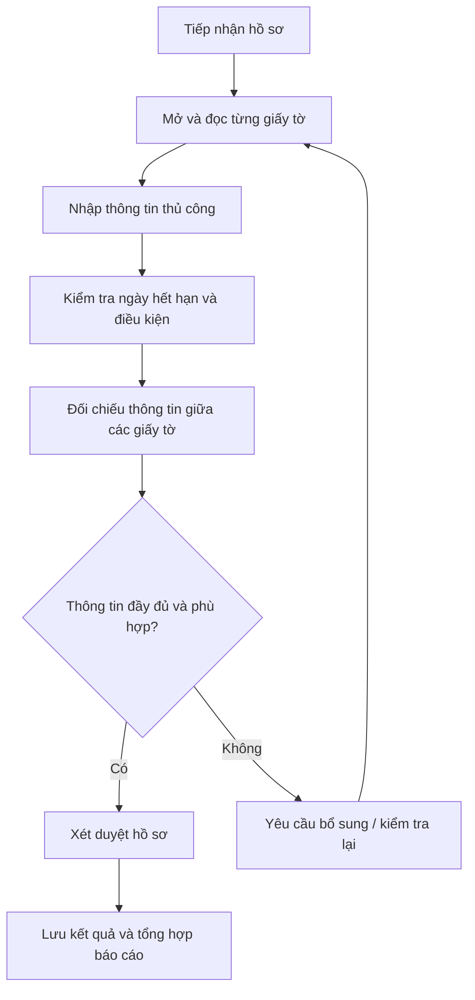
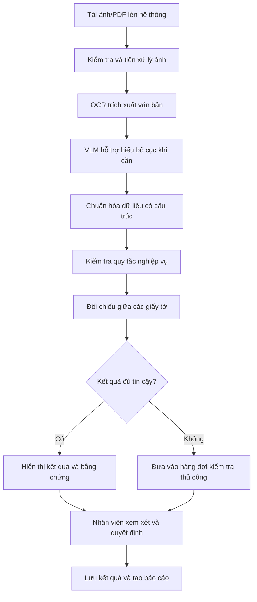

# AI20-ProblemStament-IDP-06

> **Đề tài:** DriverDocs Check – Đọc bộ giấy tờ đăng ký tài xế (CCCD, giấy phép lái xe, giấy tờ xe) và kiểm tra tính hợp lệ của từng trường thông tin.  
> **Mục đích tài liệu:** Xác định vấn đề cần giải quyết, lý do lựa chọn, các giả định cần xác minh, quy trình hiện tại và giả thuyết ứng dụng AI.

---

# 1. Problem Discovery – Khám phá vấn đề

## 1.1. Danh sách các vấn đề

| ID | Problem | Vì sao lựa chọn? | Điều chưa chắc chắn / Cần xác minh |
|---|---|---|---|
| P1 | Nhân viên phải nhập thủ công thông tin từ CCCD, GPLX và giấy tờ xe. | Tốn thời gian, lặp lại thao tác và dễ phát sinh lỗi nhập liệu. | Thời gian xử lý trung bình mỗi hồ sơ là bao lâu? Tần suất sai sót hiện tại thế nào? |
| P2 | Khó đối chiếu thông tin giữa nhiều loại giấy tờ. | Có thể bỏ sót sai lệch về họ tên, ngày sinh, số giấy tờ hoặc thông tin phương tiện. | Những trường nào thường không khớp? Nhân viên đang đối chiếu theo quy tắc nào? |
| P3 | Khó phát hiện giấy tờ hết hạn hoặc không đáp ứng điều kiện. | Có thể dẫn đến việc hồ sơ chưa đủ điều kiện vẫn được chuyển qua bước tiếp theo. | Quy tắc hợp lệ của từng loại giấy tờ là gì? Tỷ lệ hồ sơ hết hạn là bao nhiêu? |
| P4 | Chất lượng ảnh chụp giấy tờ không đồng nhất. | Ảnh mờ, nghiêng, thiếu sáng hoặc bị che khuất làm giảm khả năng đọc chính xác. | Tỷ lệ ảnh chất lượng thấp là bao nhiêu? Các loại lỗi ảnh phổ biến là gì? |
| P5 | Kết quả kiểm tra phụ thuộc nhiều vào kinh nghiệm nhân viên. | Có thể tạo ra cách đánh giá không đồng nhất giữa các nhân viên. | Doanh nghiệp đã có quy trình và bộ quy tắc xét duyệt thống nhất chưa? |
| P6 | Khó theo dõi và tổng hợp hiệu quả xét duyệt hồ sơ. | Quản lý khó theo dõi thời gian xử lý, tỷ lệ lỗi và khối lượng hồ sơ tồn. | Hiện dữ liệu và báo cáo được lưu trữ, tổng hợp như thế nào? |
| P7 | Khó thích ứng khi xuất hiện mẫu giấy tờ mới. | Thay đổi bố cục tài liệu có thể làm giảm chất lượng trích xuất hoặc cần điều chỉnh hệ thống. | Tần suất xuất hiện mẫu mới và mức độ thay đổi thực tế ra sao? |

## 1.2. Tiêu chí đánh giá và lựa chọn vấn đề

Nhóm đánh giá sơ bộ theo các tiêu chí:

- **Mức độ ảnh hưởng:** Vấn đề ảnh hưởng nhiều đến thời gian, chất lượng hoặc chi phí xử lý hồ sơ đến mức nào?
- **Tần suất:** Vấn đề có thường xuyên xảy ra trong quy trình không?
- **Khả năng ứng dụng AI:** AI có thể hỗ trợ công đoạn này một cách có kiểm chứng không?
- **Khả năng triển khai:** Nhóm có thể xây dựng và đánh giá giải pháp trong phạm vi dự án không?

| Problem | Mức độ ảnh hưởng | Khả năng ứng dụng AI | Khả năng triển khai | Định hướng |
|---|---|---|---|---|
| P1 – Nhập liệu thủ công | Cao (sơ bộ) | Cao | Cao | Chọn cho MVP |
| P2 – Khó đối chiếu thông tin | Cao (sơ bộ) | Cao | Cao | Chọn cho MVP |
| P3 – Khó phát hiện giấy tờ không hợp lệ | Cao (sơ bộ) | Trung bình–cao | Cao | Chọn cho MVP |
| P4 – Ảnh đầu vào chất lượng thấp | Trung bình–cao | Cao | Trung bình | Năng lực hỗ trợ |
| P5 – Phụ thuộc kinh nghiệm nhân viên | Cao (sơ bộ) | Trung bình | Trung bình | Giải quyết bằng quy trình kiểm duyệt |
| P6 – Thiếu báo cáo quản lý | Trung bình | Thấp–trung bình | Cao | Bổ trợ |
| P7 – Khó thích ứng mẫu mới | Trung bình | Cao | Trung bình–thấp | Hướng nâng cao |

> **Lưu ý:** Đây là đánh giá giả định ban đầu dựa trên mô tả đề bài, không phải kết quả khảo sát thực tế. Nhóm cần xác minh bằng phỏng vấn, quan sát quy trình hoặc dữ liệu thử nghiệm.

## 1.3. Vấn đề được lựa chọn

**Vấn đề trọng tâm:** Nhân viên mất nhiều thời gian và dễ mắc sai sót khi đọc, nhập liệu, kiểm tra tính hợp lệ và đối chiếu thông tin giữa nhiều loại giấy tờ đăng ký tài xế.

Phạm vi ưu tiên:

- **MVP:** P1, P2, P3.
- **Năng lực hỗ trợ:** P4.
- **Yêu cầu vận hành:** P5 – nhân viên có quyền xem xét và quyết định.
- **Mở rộng:** P6, P7.

---

# 2. Problem Card – Thẻ mô tả vấn đề

## 2.1. Thông tin chung

| Trường | Nội dung |
|---|---|
| Project | IPD-06 – DriverDocs Check |
| Problem title | Tốn thời gian và dễ sai sót khi kiểm tra giấy tờ đăng ký tài xế |
| Author | Nhóm phát triển DriverDocs Check |
| Target users | Nhân viên tuyển dụng, nhân viên xét duyệt hồ sơ tài xế |
| Stakeholders | Quản lý vận hành, bộ phận tuyển dụng, bộ phận kiểm duyệt |
| Priority | Cao – cần xác thực |
| Status | Giả thuyết ban đầu – chờ xác minh với người dùng |

## 2.2. Job Story

> Khi tiếp nhận một bộ hồ sơ đăng ký tài xế gồm CCCD, giấy phép lái xe và giấy tờ xe, tôi muốn hệ thống tự động đọc, trích xuất và đối chiếu các thông tin quan trọng, để tôi có thể nhanh chóng xác định những điểm hợp lệ, phát hiện sai lệch và đưa ra quyết định xét duyệt mà không phải kiểm tra thủ công từng trường thông tin.

## 2.3. Thời điểm và bối cảnh

Vấn đề có thể xuất hiện trong các tình huống:

- Khi doanh nghiệp tiếp nhận hồ sơ đăng ký tài xế mới.
- Khi nhân viên phải xử lý nhiều bộ giấy tờ trong cùng một ca làm việc.
- Trong các đợt tuyển dụng cao điểm, số lượng hồ sơ tăng nhanh.
- Khi tài xế gửi ảnh giấy tờ có chất lượng không đồng đều.
- Khi cần đối chiếu thông tin giữa CCCD, GPLX và giấy tờ xe.
- Khi hồ sơ thiếu thông tin hoặc có trường dữ liệu không thống nhất.

## 2.4. Quy trình hiện tại (As-Is Workflow)

1. Nhân viên tiếp nhận ảnh hoặc PDF giấy tờ từ tài xế.
2. Nhân viên mở từng tài liệu để đọc thông tin.
3. Nhân viên nhập thủ công họ tên, ngày sinh, số giấy tờ và các trường liên quan.
4. Nhân viên kiểm tra ngày hết hạn, hạng bằng và thông tin phương tiện theo quy định áp dụng.
5. Nhân viên đối chiếu thông tin giữa các loại giấy tờ.
6. Nhân viên ghi nhận trường hợp sai lệch, thiếu thông tin hoặc cần bổ sung.
7. Nhân viên quyết định duyệt, từ chối hoặc yêu cầu bổ sung hồ sơ theo thẩm quyền.
8. Kết quả được lưu trữ và tổng hợp báo cáo.

## 2.5. Bottlenecks – Điểm nghẽn

- Đọc và nhập liệu thủ công làm tăng thời gian xử lý mỗi hồ sơ.
- Nhân viên phải chuyển đổi liên tục giữa nhiều tài liệu để đối chiếu.
- Nhiều trường thông tin làm tăng nguy cơ bỏ sót lỗi.
- Ảnh mờ, nghiêng hoặc thiếu sáng làm tăng khả năng đọc sai.
- Thiếu cảnh báo tự động đối với trường dữ liệu hết hạn hoặc không khớp.
- Kết quả kiểm tra có thể phụ thuộc vào sự cẩn thận và kinh nghiệm của từng nhân viên.

## 2.6. Impact – Tác động

- Tăng thời gian xử lý hồ sơ.
- Tăng nguy cơ sai sót trong quá trình nhập liệu và đối chiếu.
- Hồ sơ có vấn đề có thể bị bỏ sót hoặc phải kiểm tra lại.
- Tăng khối lượng công việc cho nhân viên xét duyệt.
- Có thể kéo dài thời gian hoàn tất đăng ký tài xế.
- Khó đánh giá hiệu suất xử lý hồ sơ nếu thiếu dữ liệu thống kê nhất quán.

## 2.7. Success Metrics – Chỉ số thành công

| Metric | Định nghĩa / Cách đo |
|---|---|
| Extraction Accuracy | Tỷ lệ trường thông tin trích xuất chính xác so với dữ liệu chuẩn đã gán nhãn. |
| Validation Accuracy | Tỷ lệ kết quả kiểm tra hợp lệ/không hợp lệ chính xác so với kết quả chuẩn. |
| Field Match Accuracy | Khả năng phát hiện đúng các trường thông tin không khớp giữa các giấy tờ. |
| Processing Time | Thời gian trung bình từ lúc tải hồ sơ lên đến khi có kết quả kiểm tra. |
| False Positive Rate | Tỷ lệ trường hợp hợp lệ nhưng bị cảnh báo là không hợp lệ. |
| False Negative Rate | Tỷ lệ trường hợp không hợp lệ nhưng hệ thống không phát hiện. |
| Human Review Rate | Tỷ lệ hồ sơ hoặc trường dữ liệu cần nhân viên kiểm tra thủ công. |

### Mục tiêu thử nghiệm ban đầu

- Extraction Accuracy đạt từ 90% trở lên trên bộ dữ liệu kiểm thử có gán nhãn.
- Giảm ít nhất 50% thời gian xử lý so với quy trình thủ công trong thử nghiệm.
- Phát hiện đúng các trường hợp hết hạn và sai lệch theo bộ quy tắc kiểm thử.
- Không tự động đưa ra quyết định phê duyệt đối với trường hợp thiếu dữ liệu hoặc có độ tin cậy thấp.

> Các con số trên là mục tiêu đề xuất, chưa phải kết quả đạt được. Cần xây dựng baseline và bộ dữ liệu đánh giá trước khi kết luận hiệu quả.

## 2.8. Phương án ứng dụng AI

| Thành phần | Vai trò dự kiến |
|---|---|
| OCR | Nhận diện văn bản trên GPLX và Giấy đăng ký xe (những loại giấy tờ chưa có QR chuẩn hóa toàn diện).|
| VLM | Hỗ trợ hiểu bố cục, ngữ cảnh và vị trí các trường thông tin. |
| OpenCV | Tiền xử lý ảnh,Xử lý ảnh đầu vào: tự động căn chỉnh góc (Perspective Correction), khử lóa sáng (Glare removal), tăng độ tương phản và cắt viền (Edge detection).|
| Pydantic | Chuẩn hóa cấu trúc dữ liệu đầu ra, ép kiểu ngày tháng (YYYY-MM-DD), kiểm tra định dạng số CCCD (12 số), biển số xe|
| Rule-based Validation | Kiểm tra định dạng, ngày tháng, thời hạn và quy tắc nghiệp vụ. |
| Information Matching | Đối chiếu các trường thông tin giữa nhiều giấy tờ. |
| Human-in-the-loop | Chuyển trường hợp không chắc chắn cho nhân viên xem xét và quyết định. |
| QR Code Parser                  | Giải mã trực tiếp QR trên cccd giảm tải lỗi OCR                                                                     |

## 2.9. AI Hypothesis – Giả thuyết về AI

**Giả thuyết chính:**

Nếu hệ thống kết hợp OCR/VLM để trích xuất thông tin, sau đó sử dụng các quy tắc nghiệp vụ để kiểm tra và đối chiếu dữ liệu, thì nhân viên có thể giảm thời gian đọc và nhập liệu thủ công, đồng thời phát hiện sai lệch nhất quán hơn.

**Các giả thuyết cần kiểm chứng:**

1. OCR có thể trích xuất chính xác phần lớn thông tin từ giấy tờ có chất lượng ảnh phù hợp.
2. VLM có thể hỗ trợ xử lý tài liệu có bố cục khác nhau và xác định ngữ cảnh trường thông tin.
3. Rule-based Validation có thể phát hiện lỗi định dạng, ngày hết hạn và thông tin không khớp theo quy tắc đã định nghĩa.
4. Kết hợp AI với kiểm duyệt của nhân viên giúp giảm rủi ro khi hệ thống không đủ độ tin cậy.
5. Cảnh báo kèm vị trí và giá trị trích xuất giúp nhân viên kiểm tra nhanh hơn so với quy trình hiện tại.

## 2.10. Quick Workflow – Luồng xử lý AI dự kiến

| Bước | Hoạt động | Công nghệ / Thành phần |
|---|---|---|
| 1. Input | Tải ảnh/PDF giấy tờ lên hệ thống. | React / Next.js |
| 2. Preprocessing | Kiểm tra chất lượng, xoay và căn chỉnh ảnh. | OpenCV |
| 3. Extraction | Nhận diện và trích xuất văn bản. | PaddleOCR / VietOCR / Tesseract |
| 4. Understanding | Hiểu bố cục và ngữ cảnh tài liệu khi cần. | VLM |
| 5. Structuring | Chuẩn hóa dữ liệu thành cấu trúc thống nhất. | Pydantic |
| 6. Validation | Kiểm tra định dạng và quy tắc nghiệp vụ. | Python Rules |
| 7. Matching | Đối chiếu thông tin giữa các giấy tờ. | Matching Engine |
| 8. Review | Hiển thị kết quả, bằng chứng và cảnh báo để nhân viên duyệt. | React / Next.js |
| 9. Monitoring | Theo dõi chất lượng, lỗi và chi phí xử lý. | Langfuse / Logging |

## 2.11. Rủi ro và giới hạn

- OCR có thể nhận diện sai ký tự hoặc nhầm trường thông tin.
- Ảnh mờ, thiếu góc hoặc bị che khuất có thể làm giảm độ chính xác.
- VLM có thể tạo ra thông tin không xuất hiện trong tài liệu; do đó cần kiểm tra đầu ra với nội dung nguồn.
- Kết quả đọc và đối chiếu không chứng minh giấy tờ là thật hoặc xác thực về mặt pháp lý.
- Hệ thống không được tự động phê duyệt khi thiếu dữ liệu hoặc độ tin cậy thấp.
- Dữ liệu cá nhân phải được bảo vệ, giới hạn quyền truy cập và thời gian lưu trữ.
- Dữ liệu tổng hợp dùng để kiểm thử phải là dữ liệu giả lập, không sao chép hoặc chỉnh sửa từ giấy tờ thật của cá nhân.

## 2.12. Kết quả kỳ vọng

Xây dựng hệ thống hỗ trợ nhân viên tự động đọc, trích xuất, chuẩn hóa, kiểm tra và đối chiếu thông tin trên giấy tờ đăng ký tài xế. Hệ thống cung cấp kết quả kiểm tra, cảnh báo các trường hợp bất thường và bằng chứng liên quan để nhân viên đưa ra quyết định xét duyệt nhanh chóng, nhất quán và có kiểm soát.

---

# 3. Current Workflow – Phân tích quy trình hiện tại

## 3.1. As-Is – Quy trình thủ công

### Điểm nghẽn trong quy trình hiện tại

| Công đoạn | Công việc của nhân viên | Điểm nghẽn |
|---|---|---|
| Tiếp nhận | Nhận và phân loại tài liệu | Thiếu chuẩn hóa đầu vào |
| Đọc tài liệu | Quan sát từng ảnh/PDF | Tốn thời gian, phụ thuộc chất lượng ảnh |
| Nhập liệu | Ghi lại thông tin | Dễ phát sinh lỗi nhập liệu |
| Kiểm tra | Kiểm tra ngày, định dạng, điều kiện | Phải tự nhớ và áp dụng quy tắc |
| Đối chiếu | So sánh giữa các giấy tờ | Dễ bỏ sót sai lệch |
| Xét duyệt | Đưa ra quyết định | Phụ thuộc vào thông tin và thao tác trước đó |
| Báo cáo | Tổng hợp kết quả | Tốn công nếu dữ liệu chưa được cấu trúc |

## 3.2. To-Be – Quy trình đề xuất

**Nguyên tắc thiết kế:** AI hỗ trợ đọc, trích xuất và phát hiện bất thường; quy tắc nghiệp vụ xác định điều kiện kiểm tra; nhân viên chịu trách nhiệm xem xét và quyết định cuối cùng.

**Chi tiết hóa Bộ Quy tắc Nghiệp vụ Cốt lõi (Rule-based Validation)**
- Kiểm tra thời hạn (Expiration Check):
  - GPLX: Ngày hiện tại $\le$ Ngày hết hạn trên GPLX (ngoại trừ hạng A1 không thời hạn).
  - CCCD: Kiểm tra mốc hạn đổi thẻ theo độ tuổi quy định (25, 40, 60 tuổi).
- Đối chiếu chéo thông tin định danh (Cross-matching):
  - Họ và tên: Khớp tuyệt đối hoặc qua hàm chuẩn hóa chuỗi tiếng Việt (Levenshtein Distance / Cosine Similarity $\ge 0.95$ để bỏ qua lỗi dấu câu nhỏ).
  - Số định danh: Số CCCD phải trùng khớp hoàn toàn với số in trên mặt GPLX (với mẫu GPLX mới).
- Kiểm tra hạng bằng & phương tiện: Đối chiếu hạng GPLX (B1, B2, C,...) với phân khúc xe đăng ký theo đúng quy định giao thông hiện hành.
---

# 4. AI Responsibility – Phân định trách nhiệm

| Công đoạn | AI / Hệ thống hỗ trợ | Nhân viên / Quy tắc nghiệp vụ |
|---|---|---|
| Đọc giấy tờ | OCR/VLM trích xuất nội dung | Kiểm tra lại nội dung không rõ |
| Nhận diện trường | Xác định trường và vị trí | Xác nhận trường bị nhầm hoặc thiếu |
| Chuẩn hóa | Chuẩn hóa kiểu dữ liệu, định dạng | Xác nhận các trường hợp mơ hồ |
| Kiểm tra ngày | Phân tích và chuẩn hóa ngày | Quy tắc hợp lệ do nghiệp vụ xác định |
| Kiểm tra hạng bằng | Trích xuất hạng bằng | Áp dụng quy định tương ứng |
| Đối chiếu | So sánh giá trị giữa giấy tờ | Xem xét sai lệch có lý do hợp lệ |
| Đánh giá độ tin cậy | Cung cấp confidence và cảnh báo | Quyết định khi cần kiểm tra bổ sung |
| Xét duyệt | Đề xuất kết quả kiểm tra | Quyết định cuối cùng theo thẩm quyền |

> Confidence score không mặc nhiên là xác suất đúng. Nếu sử dụng ngưỡng confidence để phân luồng, nhóm cần hiệu chuẩn và đánh giá ngưỡng trên dữ liệu kiểm thử.

---

# 5. Validation Questions – Các câu hỏi cần xác minh

Nhóm cần phỏng vấn nhân viên hoặc người có hiểu biết về quy trình thực tế để kiểm chứng Problem Card.

| STT | Câu hỏi | Mục đích |
|---|---|---|
| 1 | Trung bình một nhân viên xử lý bao nhiêu hồ sơ mỗi ngày? | Xác định quy mô công việc |
| 2 | Một bộ hồ sơ mất bao lâu để kiểm tra? | Xác định baseline thời gian |
| 3 | Những trường thông tin nào thường bị nhập sai nhất? | Xác định trường ưu tiên |
| 4 | Loại giấy tờ nào khó đọc nhất? | Xác định yêu cầu trích xuất |
| 5 | Tỷ lệ ảnh mờ, nghiêng hoặc thiếu thông tin là bao nhiêu? | Đánh giá chất lượng đầu vào |
| 6 | Doanh nghiệp đang áp dụng quy tắc nào để xác định hồ sơ hợp lệ? | Xây dựng Validation Engine |
| 7 | Khi thông tin giữa hai giấy tờ không khớp, nhân viên xử lý thế nào? | Xác định quy trình ngoại lệ |
| 8 | Nhân viên có chấp nhận hệ thống đề xuất kết quả để mình kiểm tra và duyệt không? | Đánh giá khả năng chấp nhận AI |
| 9 | Những lỗi nào nghiêm trọng nhất nếu hệ thống bỏ sót? | Xác định mức độ ưu tiên |
| 10 | Có dữ liệu kiểm thử đã được gán nhãn hoặc dữ liệu tổng hợp không? | Xác định khả năng đánh giá |

- Vì dự án xử lý thông tin cá nhân nhạy cảm (CCCD, GPLX), tài liệu cần bổ sung cam kết tuân thủ:
  - Bảo mật dữ liệu cá nhân (Nghị định 13/2023/NĐ-CP): Dữ liệu ảnh và thông tin trích xuất chỉ lưu trữ trong thời gian xử lý hồ sơ; mã hóa dữ liệu khi truyền tải và lưu trữ.
  - Dữ liệu kiểm thử (Synthetic Data): Toàn bộ dữ liệu phục vụ test/demo hệ thống phải là dữ liệu giả lập hoặc đã được che mờ (masking) thông tin thật, tuyệt đối không dùng dữ liệu cá nhân thực tế vào mục đích thử nghiệm công khai.
  - Phân quyền (RBAC): Giới hạn quyền truy cập chi tiết hồ sơ tài xế chỉ cho nhân sự có thẩm quyền xét duyệt.
---

# 6. Final Problem Statement

Trong quy trình tuyển dụng và đăng ký tài xế, nhân viên phải tiếp nhận, đọc, nhập liệu và đối chiếu thông tin từ nhiều loại giấy tờ như căn cước công dân, giấy phép lái xe và giấy tờ xe. Quá trình này đòi hỏi nhiều thao tác thủ công, đặc biệt khi phải kiểm tra các trường thông tin như họ tên, ngày sinh, số giấy tờ, hạng bằng và thời hạn sử dụng.

Khi số lượng hồ sơ tăng cao hoặc chất lượng ảnh không đồng đều, nhân viên dễ gặp khó khăn trong việc trích xuất thông tin, phát hiện sai lệch và xác định các trường hợp không đáp ứng điều kiện. Điều này làm tăng thời gian xử lý, nguy cơ sai sót và khối lượng công việc kiểm duyệt.

Do đó, cần xây dựng một hệ thống hỗ trợ tự động đọc, trích xuất, chuẩn hóa, kiểm tra tính hợp lệ và đối chiếu thông tin giữa các giấy tờ đăng ký tài xế. Hệ thống cần kết hợp AI với các quy tắc nghiệp vụ và cơ chế nhân viên kiểm duyệt để cung cấp kết quả có căn cứ, giảm thao tác thủ công và nâng cao hiệu quả xử lý hồ sơ.

---

# 7. Kế hoạch kiểm chứng tiếp theo

1. Phỏng vấn người có kinh nghiệm xử lý hồ sơ tài xế để xác minh quy trình As-Is.
2. Thu thập số liệu baseline: thời gian xử lý, số trường cần nhập, tỷ lệ lỗi và tỷ lệ hồ sơ cần bổ sung.
3. Xác định danh sách trường dữ liệu và quy tắc kiểm tra cho từng loại giấy tờ.
4. Xây dựng bộ dữ liệu tổng hợp, có nhãn chuẩn và các tình huống lỗi được thiết kế có kiểm soát.
5. Đo lường OCR, đối chiếu, validation và thời gian xử lý trên cùng một bộ hồ sơ.
6. So sánh kết quả với baseline thủ công và điều chỉnh phạm vi MVP.

**Phạm vi MVP đề xuất:** Trích xuất trường thông tin chính, kiểm tra định dạng và ngày hết hạn theo quy tắc đã xác định, đối chiếu các trường giữa giấy tờ, hiển thị cảnh báo và cho phép nhân viên kiểm duyệt.
"""

